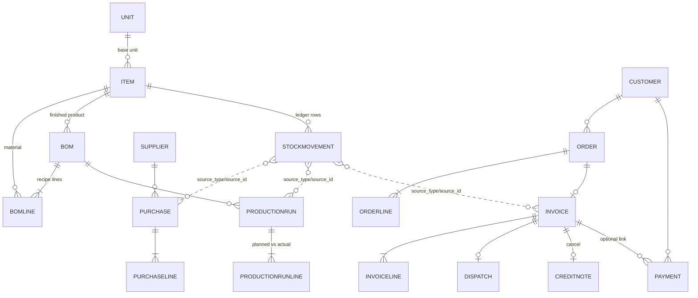

# Design note

## Data model

`AuditLog(user, at, entity, entity_id, action, detail)` and `Sequence(key, last)` (document numbers) sit beside these.

## How stock and BOM consumption are computed
* `StockMovement(item, date, type, qty signed, unit_cost, value, source_type, source_id, source_ref, batch_no)` is the only place stock lives.
  `on_hand(item) = SUM(qty)`. Rows cannot be updated or deleted. All writes go through `post_movement()`, which refuses to go below zero.
* All quantities are held in the item's base unit (kg, L, piece). `to_base(qty, unit, item)` converts g, ml and cartons of packets (carton = item's units per carton).
* Reconciliation: opening + receipts - production issues - dispatches +/- adjustments = closing; the stock summary report prints each column.
* **Production run** (one transaction): planned = BOM qty x batches; actual = what the supervisor issued (blank = plan; pouch = good + damaged).
  Check all stock first (a shortage posts nothing), post one issue per material at current weighted-average cost, post finished goods at
  (material cost + overheads) / good packets, store planned, actual and unit cost on `ProductionRunLine`.
* **Variance** = (actual - planned) / planned x 100, flagged when |variance| > BOM tolerance (3%). Yield is compared the same way against expected output.
  Tolerance and planned quantities are snapshotted on the run, so later BOM edits do not rewrite history.

## Costing and valuation
* Method: **weighted average** from the ledger (total value / total quantity), updated at every receipt.
  Chosen over FIFO for simplicity and auditability with a few raw materials bought at changing rates.
* Overheads (labour, gas/power, other) are entered per run and **allocated per good packet** (equal share). Late entries are posted as a quantity-less cost
  adjustment to finished-goods value, so the ledger stays consistent.
* Cost per packet = (materials + overheads) / good packets. Margin = selling price - cost per packet.
* Benchmark: (4,055.00 + 1,800.00) / 188 = 31.14; margin 18.86 (37.7%).

## Sales and tax
Order -> (stock check: on hand minus reserved) -> approve -> invoice -> dispatch. GST: same state as factory = CGST + SGST, otherwise IGST; invoices are
numbered `INV/<FY>/<seq>` per financial year, snapshot the buyer, and are cancelled only by credit note.
